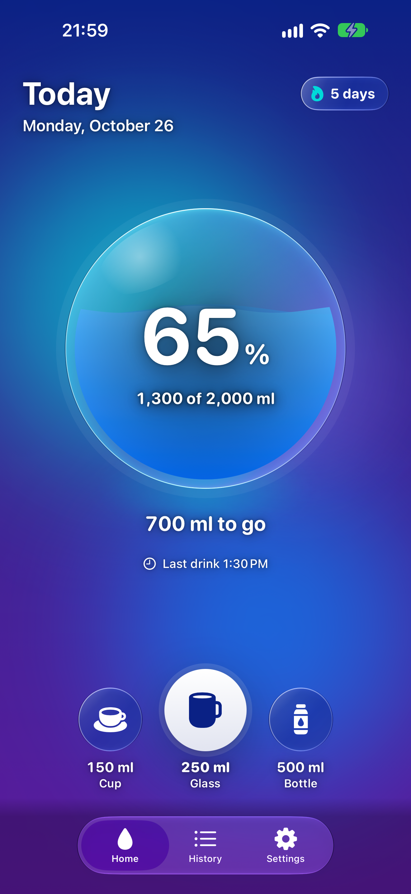
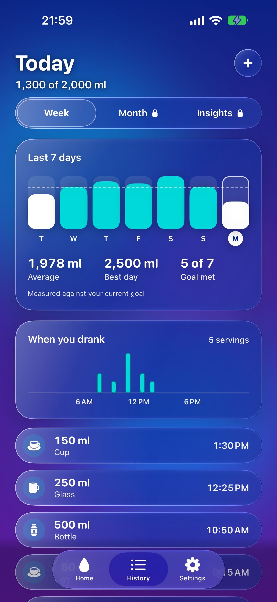
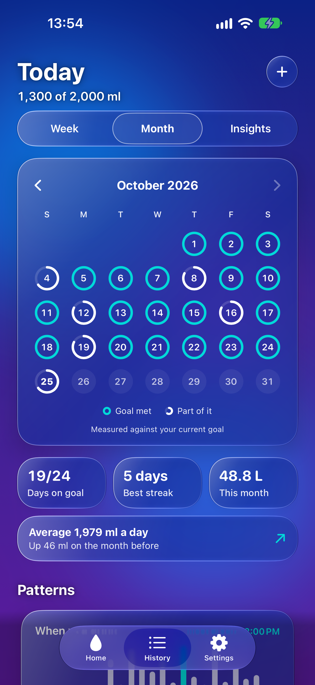
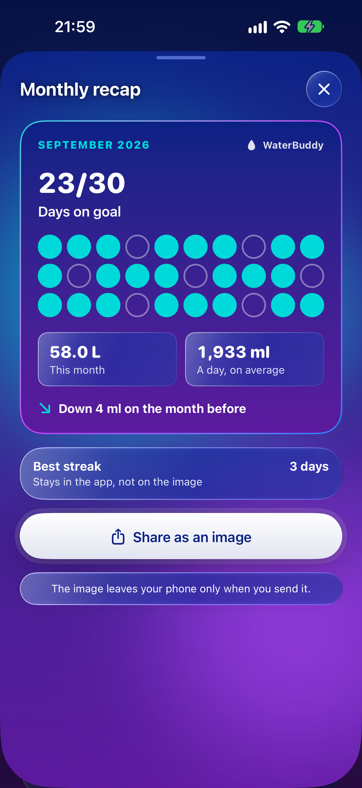

# WaterBuddy

A hydration tracker for iPhone and Apple Watch. Log a glass of water, see how the day is going, and
log again — without opening the app.

No account. No server. No analytics. No third-party dependencies of any kind.

<p align="center">
  
  
  
  
</p>

---

## What it does

- **Three quick-add vessels** — Cup 150 ml, Glass 250 ml, Bottle 500 ml, each editable from 50 to
  1,000 ml. *Undo* takes a pour back; a day streak counts the days the goal is met.
- **A daily goal**, 1,000–4,000 ml in 100 ml steps. Defaults to 2,000 ml; the first-run welcome can
  suggest one from weight and activity, and keeps neither.
- **A circular vessel** that fills with animated water, showing percentage and millilitres.
- **History** — the last seven days against the goal, each day's servings with their times, editable,
  deletable, and addable up to six days back.
- **Home Screen widgets** — small and medium, with a button that logs the Glass without opening the
  app, and a week widget; the small one draws in StandBy.
- **Lock Screen widgets** — a ring, a line and a rectangle with its own button — and a *Log Water*
  control for Control Center, the Lock Screen and the Action Button (iOS 18).
- **Siri** — *Log water in WaterBuddy* and *How much water today in WaterBuddy*, English and Russian.
- **Apple Watch app** — Cup, Glass and Bottle on the wrist; works offline and syncs when the phone is
  in range. Three complications: circular, rectangular and corner.
- **Optional reminders** — every two hours from 9 AM to 9 PM, skipped if you drank in the hour
  before one, silenced for the rest of the day once the goal is reached, with a *Log a Glass* button.
- **WaterBuddy Premium** (optional; monthly, yearly or lifetime through StoreKit) — month view and full
  history, patterns, weekly personal insights (worded on the device by Apple's on-device model where
  it is available), and a monthly recap to share as an image. Logging is never locked.
- **English, Russian and Uzbek**, switchable in-app, applied immediately.

## Requirements

| | |
|---|---|
| iPhone | iOS **17.0** or later. iPhone only — no iPad. |
| Apple Watch | watchOS **26.0** or later (optional; the iPhone app works alone). |
| Build | Xcode 26.6, Swift 5.0 language mode. |

Both floors are compile- and link-verified. Neither has been *run* — no iOS 17.x or watchOS 26.0
simulator runtime is installed on the development machine (`docs/AI_CONTEXT.md`, *Current state*).

---

## Architecture

```
        the app                              the widget extension
  HomeView · HistoryView                HydrationProvider ── reads ──┐
  SettingsView · GoalSetupView                 │                     │
          │                              AddWaterIntent ─── writes ──┤
          ▼                                    │ (@MainActor)        │
    DataManager  ◄─────────────────────────────┘                     │
    @MainActor · @Observable · the only writer                       │
          │                                                          │
    ┌─────┴─────────────────┐                                        │
    ▼                       ▼                                        │
SwiftData                UserDefaults suite  ◄───────────────────────┘
WaterBuddy.store         11 keys, derived cache
source of truth          read by the app AND the widget
app only
```

The Apple Watch is a **third, physically separate process pair** with its own local App Group suite,
written only by `WristModel`. It exchanges data with the phone solely over `WatchConnectivity` —
never through the phone's container.

### The rulings that shape it

- **One writer per store.** `DataManager` owns the phone's SwiftData store and its `UserDefaults`
  cache; `WristModel` owns the watch's own suite. No view, intent or timeline provider writes a key.
- **Today's total is derived, never authored.** It is the sum of today's logs, recomputed after every
  mutation and written back through one setter.
- **The widget's read path never opens SwiftData.** A `TimelineProvider` is `nonisolated` and a
  `ModelContext` is not `Sendable`, so the `UserDefaults` cache is what keeps that read synchronous.
- **The day is stored as a `yyyyMMdd` ordinal, never a `Date`.** An instant is re-read under whatever
  time zone is current, so a user flying west would otherwise lose a day of water on a date that
  never changed.
- **Reset writes the zero before it stamps the day.** A crash between the two leaves a stale marker
  that simply resets again; the opposite order launders yesterday's water into today.
- **Reminders are scheduled from a pure plan.** `ReminderPlan` decides *when* with no
  `UserNotifications` import at all; `NotificationManager` only files and unfiles.

Full reasoning lives in the DocC comments on each type and in [`.claude/rules/`](.claude/rules).

## Targets

Seven targets in one Xcode project, four of them signed.

| Target | Bundle id | Role |
|---|---|---|
| `WaterBuddy` | `sardor.WaterBuddy` | the iPhone app |
| `WaterBuddyWidgetExtension` | `sardor.WaterBuddy.WaterBuddyWidget` | Home Screen widget |
| `WaterBuddyWatch` | `sardor.WaterBuddy.watchkitapp` | the watch app |
| `WaterBuddyWatchWidget` | `…watchkitapp.WaterBuddyWatchWidget` | the complication |
| `WaterBuddyTests` | — | swift-testing, phone side |
| `WaterBuddyUITests` | — | XCTest, phone side |
| `WaterBuddyWatchTests` | — | swift-testing, watch side |

`xcodebuild -list` reports **four** schemes; the three test targets are driven with `-only-testing:`
against the scheme of the app that hosts them.

Six files under `WaterBuddy/` are compiled into more than one target through three separate
`PBXFileSystemSynchronizedBuildFileExceptionSet`s — one per target that reaches in. That set is a
contract, not a convenience: it is what keeps the two front doors logging the same serving.

---

## Building and testing

The gate is **five invocations, not one**. No scheme compiles a sibling's sources, so a widget-only
break passes a green app-scheme test run untouched.

```bash
xcrun simctl shutdown all

xcodebuild test -project WaterBuddy.xcodeproj -scheme WaterBuddy \
  -destination 'platform=iOS Simulator,OS=26.5,name=iPhone 17' \
  -only-testing:WaterBuddyTests -parallel-testing-enabled NO

xcodebuild test -project WaterBuddy.xcodeproj -scheme WaterBuddy \
  -destination 'platform=iOS Simulator,OS=26.5,name=iPhone 17' \
  -only-testing:WaterBuddyUITests -parallel-testing-enabled NO \
  -skip-testing:WaterBuddyUITests/AppStoreScreenshotUITests

xcodebuild test -project WaterBuddy.xcodeproj -scheme WaterBuddyWatch \
  -destination 'platform=watchOS Simulator,OS=26.5,name=Apple Watch Series 11 (46mm)' \
  -only-testing:WaterBuddyWatchTests -parallel-testing-enabled NO

xcodebuild build -project WaterBuddy.xcodeproj -scheme WaterBuddyWidgetExtension \
  -destination 'platform=iOS Simulator,OS=26.5,name=iPhone 17'

xcodebuild build -project WaterBuddy.xcodeproj -scheme WaterBuddyWatchWidget \
  -destination 'platform=watchOS Simulator,OS=26.5,name=Apple Watch Series 11 (46mm)'
```

Latest run — 2026-09-02:

| | |
|---|---|
| Phone unit | `✔ 300 tests in 33 suites passed` |
| Phone UI | `Executed 25 tests, with 0 failures` |
| Watch unit | `✔ 29 tests in 5 suites passed` |
| Both widget builds | `** BUILD SUCCEEDED **` |

**`OS=26.5` is load-bearing.** More than one runtime of each platform is installed, so an unpinned
destination is ambiguous. `-skip-testing:…/AppStoreScreenshotUITests` is also mandatory — that class
is a capture harness, not a test, and is deliberately non-idempotent.

**A green suite is not proof the product works.** The tests inject their own `UserDefaults`,
`Calendar` and clock, so they structurally cannot see a missing entitlement, a file left out of a
target, or a widget that renders blank. Neither widget's rendering has any automated coverage on
either platform.

### Known warning baseline

A full scheme build emits **38** warnings, all of the *"main actor-isolated … cannot be referenced
from a nonisolated context"* class in `DataManager.swift` and `NotificationManager.swift`. They are
pre-existing and unrelated to recent work — proven by building at two different deployment targets
and diffing the warning sets, which come out identical. The rule is *no **new** warnings against that
baseline*; closing it is tracked as known issue #29.

---

## Screenshots

`Tools/` holds a capture harness. Nothing in it is compiled into any target.

```bash
bash Tools/CaptureScreenshots.sh                      # 8 of the 10 iPhone shots, 6.9" (1:45–11:45 PM, from the 8th)
bash Tools/CapturePairScreenshots.sh setup            # a new phone + watch pair, a lived-in week on it
bash Tools/CapturePairScreenshots.sh shoot <name>     # 02-widgets, 04-lock-screen and the watch's three,
                                                      #   each once a person has placed it in DeviceHub
bash Tools/CaptureFullCensus.sh                       # every screen, state, scroll position (stale, #45)
bash Tools/VerifyScreenshots.sh                       # size / alpha / format, per App Store slot
```

Two traps these encode, both of which cause an upload rejection rather than a visible failure:

- **App Store Connect validates pixel size against the *slot* you upload to.** A 6.9″ capture
  (1320×2868) in the 6.5″ well is refused. Only one iPhone size is actually required.
- **`simctl io screenshot` writes RGBA on watchOS even with `--mask=ignored`**, because the display
  is non-rectangular — and Connect rejects any screenshot with an alpha channel.
  `Tools/FlattenPNG.swift` re-encodes to colour type 2 with the RGB planes byte-identical.

Neither capture script erases a simulator. The store capture launches the app on a throwaway suite
and an in-memory store (`-WaterBuddyFreshStart`, DEBUG only), seeded with three months of servings;
the pair script deletes and remakes only the two simulators it names.

---

## Privacy

- No account, no sign-up, no server, no cloud.
- No analytics, no tracking, no ads, no third-party SDKs. There is **no networking code in the app at
  all** — `URLSession`, `Network`, `CloudKit`, `HealthKit`, `CoreLocation` and every third-party SDK
  are banned by rule and absent in fact.
- The only entitlement on any target is the App Group. `WatchConnectivity` needs none.
- Data leaves the device only between the user's own paired iPhone and Apple Watch — and a monthly
  recap image, only when the user shares it through the system share sheet.
- **Premium** is bought from Apple through StoreKit; the paid state is read from StoreKit and kept in
  memory, never stored or sent. **Insights** are decided by the app; where Apple's on-device model
  words them, it runs on the iPhone (`FoundationModels`, `SystemLanguageModel.default` only).
- **Reminder text contains no digits** — not the total, the goal or the serving, in any language. A
  lock screen is a public surface, and a test asserts the copy is digit-free.
- Four `PrivacyInfo.xcprivacy` manifests, one per shipping bundle, declare `UserDefaults` access
  (`1C8F.1` App Group, `CA92.1` app-only) and the system boot time (`35F9.1`) as required-reason APIs.
- The privacy policy is [`PRIVACY.md`](PRIVACY.md), published as `Tools/PrivacyPolicy.html`.

## Repository layout

```
WaterBuddy/              the app — SwiftUI, @Observable DataManager over SwiftData
WaterBuddyWidget/        the Home Screen widget — StaticConfiguration + AddWaterIntent
WaterBuddyWatch/         the watch app — WristView over its own local suite
WaterBuddyWatchWidget/   the complication — .accessoryCircular
WaterBuddy*Tests/        three test targets, two platforms
Entitlements/            one App Group entitlement per signed target
Tools/                   standalone scripts, in no build target
Screenshots/             App Store assets
docs/                    AI_CONTEXT · STATE · WIDGET · DESIGN
.claude/rules/           the engineering rules this codebase is held to
```

`CLAUDE.md` and `.claude/**` are committed as files and are never members of a build target.

## License

Not yet chosen. All rights reserved until one is added.

---

# App Store Connect

Everything needed to fill in the listing for **version 1.4 (build 4)** — rewritten on 2026-10-25 from
the 1.0 listing, against the app as built. **Character counts were verified programmatically**, not
estimated — every field is inside Apple's limit, and two are exactly at it.

Fields marked 🔴 **you must supply**; nothing in the repo can answer them.

1.4 carries everything since 1.1: the redesign (roadmap release 1.2), every surface (1.3) and
WaterBuddy Premium's first set (1.4). Apple Health (1.3.3) is **not** in it — it was never built.

## App Information

| Field | Value |
|---|---|
| **Name** (≤30) | `WaterBuddy - Hydration Tracker` — **30/30**, unchanged |
| **Subtitle** (≤30) | `One tap. No account. No cloud.` — **30/30**, unchanged, and still true |
| **Bundle ID** | `sardor.WaterBuddy` |
| **SKU** | already set at 1.0's submission — it cannot change |
| **Primary category** | Health & Fitness |
| **Secondary category** | Lifestyle *(optional; may be left empty)* |
| **Primary language** | English (U.S.) |
| **Content rights** | Contains no third-party content |
| **Age rating** | **4+.** No violence, mature themes, gambling, user-generated content, messaging, web browsing or ads. Apple revised the questionnaire in 2025; answer any new question on the same facts — the app gives no medical or treatment advice, and its goal calculator and insights each say *not medical advice* |
| **Price** | **Free, with in-app purchases** — WaterBuddy Premium, below |
| **Availability** | 🔴 your choice of territories |
| **Copyright** | 🔴 e.g. `2026 Sardor Allaberganov` |

## URLs

| Field | |
|---|---|
| **Privacy Policy URL** | `https://sardorallaberganov.github.io/waterbuddy/privacy/` — the address the app links from Settings and the paywall (`PaywallView.privacyPolicy`). 🔴 **Not yet live**: it returned 404 on 2026-10-24. Put your contact address in place of `CONTACT-EMAIL` in `PRIVACY.md` and `Tools/PrivacyPolicy.html`, then publish the HTML at that path on your `sardorallaberganov.github.io` site (known issue #159) |
| **Support URL** | 🔴 required. A GitHub Issues page or a contact page on the same site is acceptable |
| **Marketing URL** | optional |
| **Terms of Use (EULA)** | Apple's standard licence — leave App Store Connect's EULA field at its default. The description links it, as guideline 3.1.2 asks of an app with subscriptions |

## Promotional text (≤170) — **164/170**

Editable any time without submitting a new build.

```
One tap logs a glass from your widget, Lock Screen, Control Center or Apple Watch. New: a week widget, three watch faces and Premium insights. No account, no cloud.
```

## Keywords (≤100) — **98/100**

No spaces after the commas — a space costs a character. No token repeats the app name or subtitle,
because Apple already indexes those. Against 1.0's list: `ml`, `offline` and `sip` out, `watch` and
`streak` in.

```
drink,intake,reminder,goal,daily,glass,bottle,cup,log,widget,watch,streak,private,h2o,thirst,habit
```

> If you change the **name** or the **subtitle**, re-check this list for overlap and re-count.

## Description (≤4000) — **3992/4000**

The first ~170 characters are all that show before the "more" link, so the opening sentence carries
the whole pitch on its own (it is 170). The *WaterBuddy Premium* paragraph is what guideline 2.3.2
asks for — four of the ten screenshots show Premium's screens — and its closing sentence is the store
page spec's (§3.7). The renewal sentence and the Terms of Use link are guideline 3.1.2's.

```
One tap logs a glass - from your Home Screen, your Lock Screen, Control Center or your Apple Watch - and you watch it fill. No account, no server, nothing to sign up for.

A water tracker only earns its place if you are still using it in week three, and the surest way to keep using one is never having to stop what you are doing.

LOGGING
- Three quick-add vessels: Cup 150 ml, Glass 250 ml, Bottle 500 ml. Each is editable from 50 to 1,000 ml, so they match the glass on your desk and the bottle in your bag.
- A daily goal from 1,000 to 4,000 ml in 100 ml steps - or let WaterBuddy suggest one from your weight and how active you are. It keeps neither.
- A vessel of moving water shows today's percentage and the exact millilitres.
- Undo a pour with one tap. Reach your goal and the screen celebrates; keep reaching it and a day streak counts along.

WITHOUT OPENING THE APP
- Home Screen widgets: small and medium, with a button that logs your Glass right there, and a week widget with your last seven days against your goal. The small one also works in StandBy.
- Lock Screen widgets: a ring, a line, and a rectangle with its own button.
- A Log Water control for Control Center, the Lock Screen and the Action Button (iOS 18 and later).
- Siri: say "Log water in WaterBuddy", or ask "How much water today in WaterBuddy". In English and Russian.
- Reminders carry a Log a Glass button, so you can log from the notification itself.

APPLE WATCH
- Cup, Glass and Bottle on your wrist. It works with your iPhone out of range and syncs when it is back.
- Three complications - circular, rectangular and corner - put today's progress on your watch face.

LOOKING BACK
- Your last seven days as bars against your goal, with your average and your best day.
- Every serving with its time. Change an amount or a time, delete a mistap, or add one you forgot.

REMINDERS THAT KNOW WHEN TO STOP
Optional, and off until you turn them on: a nudge every two hours from 9 AM to 9 PM, skipped if you drank in the hour before it. Reach your goal and the rest of the day stays quiet. Reminder text contains no numbers at all: a lock screen is a public surface, and what you have drunk today is nobody else's business.

WATERBUDDY PREMIUM
Optional, for seeing how you really drink:
- Month view and full history: every day you have logged, a month at a glance.
- Your patterns: when in the day you drink, weekdays against weekends, your usual first and last drink.
- Personal insights: each week, the one thing that stands out, what is working and what is worth knowing, worked out from your own figures on your iPhone. Where Apple's on-device model is available, it can word them, in English. Not medical advice.
- A monthly recap: your month in one card, yours to share as an image.
Premium is a monthly or yearly subscription - the yearly plan starts with a free week - or a one-time lifetime purchase. Logging water is always free.

PRIVATE BY CONSTRUCTION
No account. No sign-up. No email address. No server, and no cloud.
No analytics, no tracking, no ads and no third-party code: every framework in WaterBuddy is Apple's own, and there is no networking code in it, so what you log has no way to leave your device. It travels only between your own iPhone and Apple Watch, and a recap image leaves only when you share it.

MADE TO LIVE WITH
- A dark liquid-glass design over a slowly moving aurora.
- English, Russian and Uzbek, switched inside the app.
- VoiceOver, Dynamic Type, Reduce Motion and Reduce Transparency.

WHAT IT IS NOT
It is not a medical app and makes no health claims. No Apple Health. No friends, no feeds, no leaderboards. Water, and nothing else.

Subscriptions renew automatically unless cancelled at least 24 hours before the end of the current period, in your Apple Account settings. Terms of Use: https://www.apple.com/legal/internet-services/itunes/dev/stdeula/

Requires iOS 17.0 or later on iPhone. The Log Water control needs iOS 18, and the Apple Watch app watchOS 26.0.
```

## What's New — version 1.4 — **830/4000**

Written against **1.1**, which already brought the Lock Screen widget, the Control Center control,
the *Log water* Siri phrase and adding a serving at an earlier time. 1.1's App Review outcome is not
recorded here: if it never reached the store, add a line for those four before the last one.

```
WaterBuddy 1.4 - a new look, more ways in, and Premium.

- Redesigned throughout: liquid glass over a moving aurora, a calmer Home, History rebuilt around your week, and a new Settings.
- A first-run welcome that can suggest a goal from your weight and how active you are - and keeps neither.
- Undo a pour with one tap, and a day streak for the days you reach your goal.
- A week widget for the Home Screen, and the small widget now works in StandBy.
- Three Apple Watch complications - circular, rectangular and corner - and a redesigned watch app.
- Log a Glass straight from a reminder, without opening the app.
- Ask Siri "How much water today in WaterBuddy".
- WaterBuddy Premium, optional: month view and full history, your patterns, weekly personal insights and a monthly recap you can share. Logging water is always free.
```

## In-App Purchases — WaterBuddy Premium 🔴

Nothing here exists in App Store Connect yet (known issue #155); the app reads these three product
IDs and nothing else (`PremiumAccess.productIDs`). The names, descriptions, prices and trial below
are the local StoreKit configuration's (`WaterBuddyTests/WaterBuddy.storekit`) — the prices are a
recommendation, yours to change.

**First:** Agreements, Tax and Banking → the **Paid Apps Agreement**, with banking and tax completed.
Without it no product can be sold.

**One subscription group**, reference name and display name `WaterBuddy Premium`, with two
auto-renewable subscriptions, plus one non-consumable:

| Product ID | Type | Reference name | Display name (≤30) | Description (≤45) | Price | Offer |
|---|---|---|---|---|---|---|
| `sardor.WaterBuddy.premium.yearly` | auto-renewable, 1 year, level 1 | Premium Yearly | `Premium Yearly` | `Every Premium extra, renewed each year.` | $19.99 | introductory offer: **free trial, 1 week**, new subscribers |
| `sardor.WaterBuddy.premium.monthly` | auto-renewable, 1 month, level 2 | Premium Monthly | `Premium Monthly` | `Every Premium extra, renewed each month.` | $2.99 | none |
| `sardor.WaterBuddy.premium.lifetime` | non-consumable | Premium Lifetime | `Premium Lifetime` | `Every Premium extra, paid once.` | $39.99 | — |

- **Family Sharing** is on for all three in the local configuration. In App Store Connect, turning it
  on for a product cannot be undone — decide before you save.
- **Review information**, for each product: a screenshot of the paywall (Settings → *See Premium*),
  taken from a run of the `WaterBuddy` scheme in Xcode — that run buys from the local StoreKit
  configuration, so its prices draw. Review note: *Unlocks Month view, Patterns, Insights and the
  Monthly recap in History. Logging water is never locked.*
- **First submission:** new in-app purchases go to App Review **with a new app version**. On the 1.4
  version page, under *In-App Purchases and Subscriptions*, select all three before you submit.
- **Localizations:** English is enough to submit; Russian and Uzbek display names are optional.
- Before uploading, make one sandbox purchase, a restore and a refund on a real iPhone (#156): the
  local configuration is all that has ever been bought from.

## App Privacy

This is the questionnaire in the sidebar, and it is **separate from** the `PrivacyInfo.xcprivacy`
files in the repo. Those declare *API usage*; this declares *data collection*.

> **Answer: "Data Not Collected"** — select it and you are done. Do not tick a single data type.

Every category is answered by the same fact: there is no networking code in the app, so there is no
mechanism by which data could be collected. 1.4 changes none of it:

- **Premium purchases** are made and held by Apple under the user's own Apple Account; StoreKit
  verifies them on the device, and the app stores nothing about a purchase and sends nothing anywhere.
- **Insights** are worked out on the iPhone; where Apple's on-device model rewords them, it runs on
  the iPhone too — never Private Cloud Compute (rule `70-privacy`).
- **The recap image** leaves only through the system share sheet, on the user's tap, to a
  destination the app never learns.

The privacy policy (`PRIVACY.md`, published as `Tools/PrivacyPolicy.html`) says the same and gives the
label as *Data Not Collected*.

| Question | Answer |
|---|---|
| Do you collect data from this app? | **No** |
| Contact info, Health, Financial, Location, Identifiers, Usage, Diagnostics | **None** |
| Third-party analytics / advertising | **None** |
| Tracking (ATT) | **No** — the app does not track |

## Export compliance

Already answered **in the build** via `INFOPLIST_KEY_ITSAppUsesNonExemptEncryption = NO`, so App
Store Connect should not prompt. If it does:

| Question | Answer |
|---|---|
| Does your app use encryption? | **No** |
| Exempt? | n/a — the app uses no encryption of any kind |

## Screenshots

In [`Screenshots/en-US/`](Screenshots/en-US), English only, raw — no frame, no headline — and every
file checked by `bash Tools/VerifyScreenshots.sh`. **Only the 6.9″ well is filled**: Apple's spec makes
6.5″ *"required if screenshots for 6.9″ display aren't provided"*, and Connect scales the 6.9″ set
down for the smaller phones. Delete any 6.5″ shots left from 1.0 in Connect, since they show the old
app.

| Slot | Size | Files |
|---|---|---|
| iPhone 6.9″ | 1320 × 2868 (iPhone 18 Pro Max, iOS 27.0) | 10 |
| Apple Watch | 416 × 496 (Series 12, 46mm, watchOS 27.0) | 3 — **required**, because the app embeds a watchOS app |
| Product page header | 3840 × 1646 | 1 — `ProductPageHeader/01-one-tap.png`, *One tap. Watch it fill.* |

Upload in file order — only the **first three** appear on search results and install cards:

| # | iPhone | Shows |
|---|---|---|
| 01 | `01-home.png` | Home at 65 %, *1,300 of 2,000 ml*, a five-day streak |
| 02 | `02-widgets.png` | the Home Screen: the small and medium Hydration widgets and the week widget |
| 03 | `03-history.png` | History's week, today shown, *Month* and *Insights* locked for a free user |
| 04 | `04-lock-screen.png` | the Lock Screen widgets and the *Log Water* control |
| 05 | `05-month.png` | Premium: this month's calendar and figures |
| 06 | `06-insights.png` | Premium: last week's insights |
| 07 | `07-patterns.png` | Premium: the month's patterns |
| 08 | `08-recap.png` | Premium: last month's recap card |
| 09 | `09-goal-setup.png` | the welcome's goal step |
| 10 | `10-settings.png` | Settings, the Premium card first |

| # | Apple Watch | Shows |
|---|---|---|
| 01 | `01-wrist.png` | the watch app, synced from the phone, at 65 % |
| 02 | `02-face-modular.png` | Modular, with the rectangle and the circle |
| 03 | `03-face-infograph.png` | Infograph, with the corner and the circle |

Shots 01, 03 and 05–10 come from `bash Tools/CaptureScreenshots.sh` (1:45–11:45 PM, from the 8th of a
month); 02, 04 and the watch's three from `bash Tools/CapturePairScreenshots.sh setup`, then
`shoot <name>` once a person has placed each surface in DeviceHub.

## Review notes

```
No account or login is required. On first launch a short welcome asks for a daily goal (it can suggest one from weight and activity level, which it does not keep); the app is fully usable straight after. No demo credentials are needed.

WaterBuddy Premium unlocks Month view, Patterns, Insights and the Monthly recap, all in the History tab. It is sold through StoreKit as a monthly or yearly auto-renewable subscription (the yearly with a one-week free trial) or a one-time lifetime purchase. Open the paywall from Settings > See Premium, or from History's locked Month or Insights; Restore Purchases is on the same screen. Logging water is free and never locked.

Premium's screens need some history before they show content. Month view shows at once; Insights and Patterns each say how many days of water they need until they have them. Servings can be added to today and the six days before it with the + in History. Insights appear once the last finished week holds four days with water, Patterns once the month holds seven finished days with water (today is not counted), and the Monthly recap for a finished month with seven days of water - so a new install shows no recap.

Insights are decided by the app from the user's own weekly figures. Where Apple's on-device model is available and the app is in English, the model may reword them on the iPhone; otherwise the app's own sentences are shown. Nothing is sent off the device.

The app collects no data and contains no networking code. Everything is stored locally in an App Group container shared by the app and its widgets; the Apple Watch app syncs over WatchConnectivity between the user's own paired devices only. A recap image leaves the device only when the user shares it through the system share sheet.

Notification permission is requested only when the user turns on reminders (in Settings, or on the welcome's last step), never at launch.

Siri, in English: "Log water in WaterBuddy" and "How much water today in WaterBuddy".
```

| Field | |
|---|---|
| Sign-in required | **No** |
| Demo account | Not needed |
| Contact 🔴 | your name, phone, email |

---

## Before you submit — outstanding (1.4, read 2026-10-25)

**Blocking — the upload or the review fails without these, and each is yours:**

- 🔴 **The privacy policy must be live** (known issue #159). Replace `CONTACT-EMAIL` in `PRIVACY.md`
  and `Tools/PrivacyPolicy.html`, publish the HTML at
  `https://sardorallaberganov.github.io/waterbuddy/privacy/`, and open that address to see it load.
  Both the app (Settings, the paywall) and the listing link it; guideline 5.1.1(i).
- 🔴 **Premium in App Store Connect** (#155): the Paid Apps Agreement with banking and tax, the
  *WaterBuddy Premium* group and its three products as listed above, each with its review screenshot,
  and all three selected on the 1.4 version page.
- 🔴 **One real purchase first** (#156, #187). A Release build offers the paywall, so before uploading
  make a sandbox purchase, a restore and a refund on a real iPhone. Nothing but the local StoreKit
  configuration has ever been bought from, and a comma-decimal region's yearly saving is unchecked
  there (#162).
- 🔴 **A Support URL.**
- **The four shots placed by hand**, if any is still missing from `Screenshots/en-US/`: `02-widgets`,
  `04-lock-screen`, `02-face-modular` and `03-face-infograph`.

**Done in the repository:**

- **Version 1.4, build 4**, on all fourteen sites in `project.pbxproj`; read back as `1.4 (4)` from
  the built app, its widget extension, the watch app and the watch widget.
- **Privacy manifests**: all four declare `UserDefaults` (`1C8F.1`, `CA92.1`) and the system boot time
  (`35F9.1`), and `PrivacyManifestTests` pins them. No check sees a *new* required-reason API (#190) —
  search the code for one before each upload.
- **Export compliance** is answered in the build (`ITSAppUsesNonExemptEncryption = NO`).
- **Distribution signing and the App Group registration**: 1.1 reached App Review on 2026-10-09, so
  both were in place then — inferred from that, not re-checked — and 1.4 adds no target and no
  entitlement.

**Your call before shipping — not checked by anything automated:**

- **Russian and Uzbek on Premium's screens are drafts** that no native speaker has read: the month
  view, Patterns, Insights and the recap (#170, #175, #179, #185).
- **Nothing has been tried on a real iPhone or Apple Watch** — the roadmap's device sweep (1.2.7) has
  never run: the widgets and StandBy, the Lock Screen widget, the control, the reminder's *Log a
  Glass*, Siri, the watch's faces and pour row, and Insights worded by Apple's on-device model (#178).
- **Premium's colour pairs are measured on iOS 27.0 only** (#165, #169, #174, #181, #186); their
  records ask for iOS 26.5 and 18.6 too.
- **Whether deleting the app removes its data on a device** (#188) — the policy and a code comment
  disagree; one of them changes.
- **Six files Xcode rewrote outside any task** sit uncommitted: `.claude/settings.json`, two watch
  schemes and three string catalogues — `AppShortcuts.xcstrings` among them, its Siri phrases marked
  `stale`. An archive builds from the working tree, so look at them or set them aside first.
- **The app icon appears only after a build is processed.** The 1024² marketing icon ships *inside*
  the binary's asset catalog — App Store Connect has no icon upload field.
