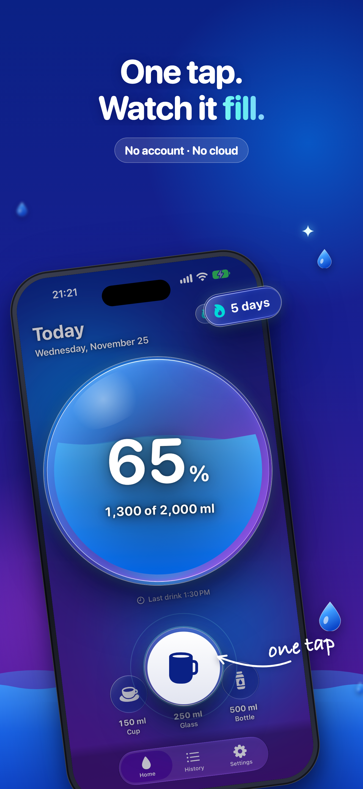
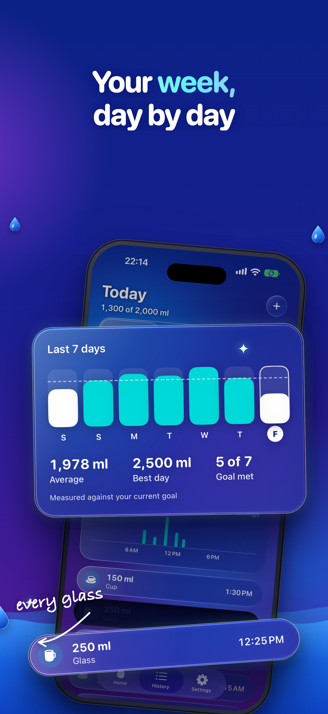
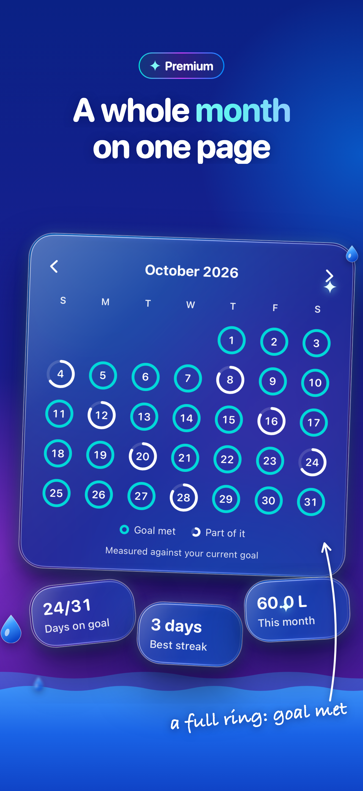
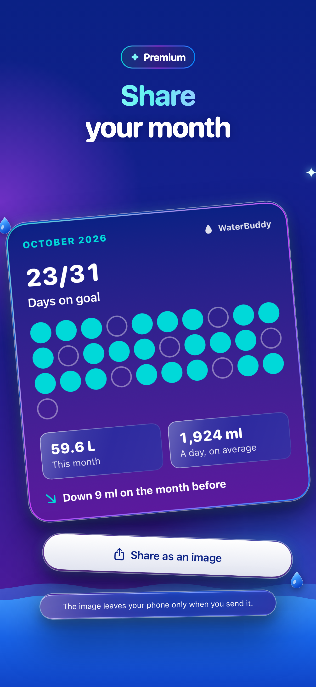

# WaterBuddy

A hydration tracker for iPhone and Apple Watch. Log a glass of water, see how the day is going, and
log again — without opening the app.

No account. No server. No analytics. No third-party dependencies of any kind.

<p align="center">
  
  
  
  
</p>

---

## What it does

- **Three quick-add vessels** — Cup 150 ml, Glass 250 ml, Bottle 500 ml, each editable from 50 to
  1,000 ml. *Undo* takes a pour back; a day streak counts the days the goal is met.
- **A daily goal**, 1,000–4,000 ml in 100 ml steps. Defaults to 2,000 ml; the first-run welcome can
  suggest one from weight and activity, and keeps neither.
- **A circular vessel** that fills with animated water, showing percentage and millilitres.
- **History** — the last seven days against the goal, each day's servings with their times, editable,
  deletable, and addable up to six days back.
- **Home Screen widgets** — small and medium, with a button that logs the Glass without opening the
  app, and a week widget; the small one draws in StandBy.
- **Lock Screen widgets** — a ring, a line and a rectangle with its own button — and a *Log Water*
  control for Control Center, the Lock Screen and the Action Button (iOS 18).
- **Siri** — *Log water in WaterBuddy* and *How much water today in WaterBuddy*, English and Russian.
- **Apple Watch app** — Cup, Glass and Bottle on the wrist; works offline and syncs when the phone is
  in range. Three complications: circular, rectangular and corner.
- **Optional reminders** — every two hours from 9 AM to 9 PM, or on Premium's own schedule, skipped if
  you drank in the hour before one, silenced for the rest of the day once the goal is reached, with a
  *Log a Glass* button.
- **Apple Health** (optional, off until turned on in Settings) — every serving written to Health as
  Water, corrected and deleted with it. Nothing is read from Health.
- **WaterBuddy Premium** (optional; monthly, yearly or lifetime through StoreKit) — month view and full
  history, patterns, weekly personal insights (worded on the device by Apple's on-device model where
  it is available), a monthly recap to share as an image, your own reminder schedule, a pace line,
  reminders only when behind, and every serving exported as a CSV file. Logging is never locked.
- **English, Russian and Uzbek**, switchable in-app, applied immediately.

## Requirements

| | |
|---|---|
| iPhone | iOS **17.0** or later. iPhone only — no iPad. |
| Apple Watch | watchOS **26.0** or later (optional; the iPhone app works alone). |
| Build | Xcode 26.6, Swift 5.0 language mode. |

Both floors are compile- and link-verified. Neither has been *run* — no iOS 17.x or watchOS 26.0
simulator runtime is installed on the development machine (`docs/AI_CONTEXT.md`, *Current state*).

---

## Architecture

```
        the app                              the widget extension
  HomeView · HistoryView                HydrationProvider ── reads ──┐
  SettingsView · GoalSetupView                 │                     │
          │                              AddWaterIntent ─── writes ──┤
          ▼                                    │ (@MainActor)        │
    DataManager  ◄─────────────────────────────┘                     │
    @MainActor · @Observable · the only writer                       │
          │                                                          │
    ┌─────┴─────────────────┐                                        │
    ▼                       ▼                                        │
SwiftData                UserDefaults suite  ◄───────────────────────┘
WaterBuddy.store         11 keys, derived cache
source of truth          read by the app AND the widget
app only
```

The Apple Watch is a **third, physically separate process pair** with its own local App Group suite,
written only by `WristModel`. It exchanges data with the phone solely over `WatchConnectivity` —
never through the phone's container.

### The rulings that shape it

- **One writer per store.** `DataManager` owns the phone's SwiftData store and its `UserDefaults`
  cache; `WristModel` owns the watch's own suite. No view, intent or timeline provider writes a key.
- **Today's total is derived, never authored.** It is the sum of today's logs, recomputed after every
  mutation and written back through one setter.
- **The widget's read path never opens SwiftData.** A `TimelineProvider` is `nonisolated` and a
  `ModelContext` is not `Sendable`, so the `UserDefaults` cache is what keeps that read synchronous.
- **The day is stored as a `yyyyMMdd` ordinal, never a `Date`.** An instant is re-read under whatever
  time zone is current, so a user flying west would otherwise lose a day of water on a date that
  never changed.
- **Reset writes the zero before it stamps the day.** A crash between the two leaves a stale marker
  that simply resets again; the opposite order launders yesterday's water into today.
- **Reminders are scheduled from a pure plan.** `ReminderPlan` decides *when* with no
  `UserNotifications` import at all; `NotificationManager` only files and unfiles.

Full reasoning lives in the DocC comments on each type and in [`.claude/rules/`](.claude/rules).

## Targets

Seven targets in one Xcode project, four of them signed.

| Target | Bundle id | Role |
|---|---|---|
| `WaterBuddy` | `sardor.WaterBuddy` | the iPhone app |
| `WaterBuddyWidgetExtension` | `sardor.WaterBuddy.WaterBuddyWidget` | Home Screen widget |
| `WaterBuddyWatch` | `sardor.WaterBuddy.watchkitapp` | the watch app |
| `WaterBuddyWatchWidget` | `…watchkitapp.WaterBuddyWatchWidget` | the complication |
| `WaterBuddyTests` | — | swift-testing, phone side |
| `WaterBuddyUITests` | — | XCTest, phone side |
| `WaterBuddyWatchTests` | — | swift-testing, watch side |

`xcodebuild -list` reports **four** schemes; the three test targets are driven with `-only-testing:`
against the scheme of the app that hosts them.

Six files under `WaterBuddy/` are compiled into more than one target through three separate
`PBXFileSystemSynchronizedBuildFileExceptionSet`s — one per target that reaches in. That set is a
contract, not a convenience: it is what keeps the two front doors logging the same serving.

---

## Building and testing

The gate is **five invocations, not one**. No scheme compiles a sibling's sources, so a widget-only
break passes a green app-scheme test run untouched.

```bash
xcrun simctl shutdown all

xcodebuild test -project WaterBuddy.xcodeproj -scheme WaterBuddy \
  -destination 'platform=iOS Simulator,OS=26.5,name=iPhone 17' \
  -only-testing:WaterBuddyTests -parallel-testing-enabled NO

xcodebuild test -project WaterBuddy.xcodeproj -scheme WaterBuddy \
  -destination 'platform=iOS Simulator,OS=26.5,name=iPhone 17' \
  -only-testing:WaterBuddyUITests -parallel-testing-enabled NO \
  -skip-testing:WaterBuddyUITests/AppStoreScreenshotUITests

xcodebuild test -project WaterBuddy.xcodeproj -scheme WaterBuddyWatch \
  -destination 'platform=watchOS Simulator,OS=26.5,name=Apple Watch Series 11 (46mm)' \
  -only-testing:WaterBuddyWatchTests -parallel-testing-enabled NO

xcodebuild build -project WaterBuddy.xcodeproj -scheme WaterBuddyWidgetExtension \
  -destination 'platform=iOS Simulator,OS=26.5,name=iPhone 17'

xcodebuild build -project WaterBuddy.xcodeproj -scheme WaterBuddyWatchWidget \
  -destination 'platform=watchOS Simulator,OS=26.5,name=Apple Watch Series 11 (46mm)'
```

Latest run — 2026-09-02:

| | |
|---|---|
| Phone unit | `✔ 300 tests in 33 suites passed` |
| Phone UI | `Executed 25 tests, with 0 failures` |
| Watch unit | `✔ 29 tests in 5 suites passed` |
| Both widget builds | `** BUILD SUCCEEDED **` |

**`OS=26.5` is load-bearing.** More than one runtime of each platform is installed, so an unpinned
destination is ambiguous. `-skip-testing:…/AppStoreScreenshotUITests` is also mandatory — that class
is a capture harness, not a test, and is deliberately non-idempotent.

**A green suite is not proof the product works.** The tests inject their own `UserDefaults`,
`Calendar` and clock, so they structurally cannot see a missing entitlement, a file left out of a
target, or a widget that renders blank. Neither widget's rendering has any automated coverage on
either platform.

### Known warning baseline

A full scheme build emits **38** warnings, all of the *"main actor-isolated … cannot be referenced
from a nonisolated context"* class in `DataManager.swift` and `NotificationManager.swift`. They are
pre-existing and unrelated to recent work — proven by building at two different deployment targets
and diffing the warning sets, which come out identical. The rule is *no **new** warnings against that
baseline*; closing it is tracked as known issue #29.

---

## Screenshots

`Tools/` holds a capture harness. Nothing in it is compiled into any target.

```bash
bash Tools/CaptureScreenshots.sh                      # the 10 raw iPhone shots, 6.9" (1:45–11:45 PM)
bash Tools/FrameScreenshots.sh                        # frames them into the upload set
bash Tools/CapturePairScreenshots.sh setup            # a new phone + watch pair, a lived-in week on it
bash Tools/CapturePairScreenshots.sh shoot <name>     # 01-wrist, 02-widgets and 04-lock-screen (1.4.1's set),
                                                      #   and the two faces — each once placed, by the
                                                      #   simulator tool or a person in DeviceHub
bash Tools/CaptureFullCensus.sh                       # every screen, state, scroll position (stale, #45)
bash Tools/VerifyScreenshots.sh                       # size / alpha / format, per App Store slot
bash Tools/VerifyListing.sh                           # every store text field, counted, per language
```

Two traps these encode, both of which cause an upload rejection rather than a visible failure:

- **App Store Connect validates pixel size against the *slot* you upload to.** A 6.9″ capture
  (1320×2868) in the 6.5″ well is refused. Only one iPhone size is actually required.
- **`simctl io screenshot` writes RGBA on watchOS even with `--mask=ignored`**, because the display
  is non-rectangular — and Connect rejects any screenshot with an alpha channel.
  `Tools/FlattenPNG.swift` re-encodes to colour type 2 with the RGB planes byte-identical.

Neither capture script erases a simulator. The store capture launches the app on a throwaway suite
and an in-memory store (`-WaterBuddyFreshStart`, DEBUG only), seeded with three months of servings;
the pair script deletes and remakes only the two simulators it names.

---

## Privacy

- No account, no sign-up, no server, no cloud.
- No analytics, no tracking, no ads, no third-party SDKs. There is **no networking code in the app at
  all** — `URLSession`, `Network`, `CloudKit`, `CoreLocation` and every third-party SDK are banned by
  rule and absent in fact.
- **Apple Health** is the one framework of that kind admitted: `HealthKit`, imported in one file of the
  app, writes Water when the user turns *Apple Health* on, and reads nothing (rule `70-privacy`).
- The App Group is the only entitlement on the widget and the watch; the app's also carries
  `com.apple.developer.healthkit`. `WatchConnectivity` needs none.
- Data leaves the device only between the user's own paired iPhone and Apple Watch, into Apple Health
  on the user's switch, and as a monthly recap image or a CSV export, only when the user shares it
  through the system share sheet.
- **Premium** is bought from Apple through StoreKit; the paid state is read from StoreKit and kept in
  memory, never stored or sent. **Insights** are decided by the app; where Apple's on-device model
  words them, it runs on the iPhone (`FoundationModels`, `SystemLanguageModel.default` only).
- **Reminder text contains no digits** — not the total, the goal or the serving, in any language. A
  lock screen is a public surface, and a test asserts the copy is digit-free.
- Four `PrivacyInfo.xcprivacy` manifests, one per shipping bundle, declare `UserDefaults` access
  (`1C8F.1` App Group, `CA92.1` app-only) and the system boot time (`35F9.1`) as required-reason APIs.
- The privacy policy is [`PRIVACY.md`](PRIVACY.md), published as `Tools/PrivacyPolicy.html`.

## Repository layout

```
WaterBuddy/              the app — SwiftUI, @Observable DataManager over SwiftData
WaterBuddyWidget/        the Home Screen widget — StaticConfiguration + AddWaterIntent
WaterBuddyWatch/         the watch app — WristView over its own local suite
WaterBuddyWatchWidget/   the complication — .accessoryCircular
WaterBuddy*Tests/        three test targets, two platforms
Entitlements/            one entitlements file per signed target: the App Group; the app's adds HealthKit
Tools/                   standalone scripts, in no build target
AppStore/                the current version's store page: the listing's text, one file per field, and
                         every screenshot — raw captures and the framed upload set
docs/                    AI_CONTEXT · STATE · WIDGET · DESIGN
.claude/rules/           the engineering rules this codebase is held to
```

`CLAUDE.md` and `.claude/**` are committed as files and are never members of a build target.

## License

Not yet chosen. All rights reserved until one is added.

---

# App Store Connect

Everything needed to fill in the listing for **version 1.4.1 (build 7)** — rewritten on 2026-10-25 from
the 1.0 listing, against the app as built, again on 2026-11-04 for Apple Health, set B and export, and on
2026-11-20 for search: the name, the subtitle and the keywords, with English (U.K.) and Russian listings
beside the en-US one (spec `docs/superpowers/specs/2026-11-20-release-1-4-1-design.md`).
**Character counts were verified programmatically**, not
estimated (`bash Tools/VerifyListing.sh`): every field is inside Apple's limit, and one, the subtitle, is
exactly at it.

Fields marked 🔴 **you must supply**; nothing in the repo can answer them.

**The upload folder is [`AppStore/`](AppStore)** — this section's text one file per field, and every
screenshot in upload order, with a start-here checklist. It holds the current version only (the owner's
ruling, 2026-11-06); this section stays the master copy, so a change here is made there too.

1.4 carries everything since 1.1: the redesign (roadmap release 1.2), every surface (1.3) — Apple Health
(1.3.3) among it — and WaterBuddy Premium: set A, set B and export (1.4), with the finish across the app
(spec `docs/superpowers/specs/2026-11-04-release-1-4-design.md`). 1.4 is live since 2026-11-13. 1.4.1 fixes
the yearly saving where prices are written with a decimal comma (#162), and asks for a rating on the first
goal day.

## App Information

| Field | Value |
|---|---|
| **Name** (≤30) | `Water Tracker - WaterBuddy` — **26/30**: the main keyword first, then the brand (1.4.1, spec §5.1) |
| **Subtitle** (≤30) | `Stay Hydrated: Reminder Widget` — **30/30**: two lightly held phrases, never a slogan (1.4.1, spec §5.1) |
| **Bundle ID** | `sardor.WaterBuddy` |
| **SKU** | already set at 1.0's submission — it cannot change |
| **Primary category** | Health & Fitness |
| **Secondary category** | Lifestyle *(optional; may be left empty)* |
| **Primary language** | English (U.S.) |
| **Other listings** | English (U.K.) and Russian, new in 1.4.1 — [`AppStore/en-GB/`](AppStore/en-GB) and [`AppStore/ru/`](AppStore/ru), one file per field |
| **Content rights** | Contains no third-party content |
| **Age rating** | **4+.** No violence, mature themes, gambling, user-generated content, messaging, web browsing or ads. Apple revised the questionnaire in 2025; answer any new question on the same facts — the app gives no medical or treatment advice, and its goal calculator and insights each say *not medical advice* |
| **Price** | **Free, with in-app purchases** — WaterBuddy Premium, below |
| **Availability** | 🔴 your choice of territories |
| **Copyright** | `2026 Sardor Allaberganov` |

## URLs

| Field | |
|---|---|
| **Privacy Policy URL** | `https://sardorallaberganov.github.io/waterbuddy/privacy/` — the address the app links from Settings and the paywall (`PaywallView.privacyPolicy`). Live since 2026-11-06: `Tools/PrivacyPolicy.html`, published as `waterbuddy/privacy/index.html` in your `SardorAllaberganov.github.io` repository (known issue #159). 🔴 **Publish it again before 1.4.1 is submitted**: its §3, on the rating request, changed. If Connect asks for the address in English (U.K.) or Russian, it is the same |
| **Support URL** | `https://sardorallaberganov.github.io/waterbuddy/support/` — live since 2026-11-06: `Tools/Support.html`, read from the code (contact, logging, widgets and Siri, the Watch, reminders, Premium, your data), published as `waterbuddy/support/index.html` in the same repository. The same address in every language |
| **Marketing URL** | optional |
| **Terms of Use (EULA)** | Apple's standard licence — leave App Store Connect's EULA field at its default. The description links it, as guideline 3.1.2 asks of an app with subscriptions |

## Promotional text (≤170) — **136/170**

Editable any time without submitting a new build.

```
One tap logs a glass from your widget, Lock Screen, Control Center or Apple Watch. Logging is always free: no ads, no account, no cloud.
```

## Keywords (≤100) — **99/100**

No spaces after the commas — a space costs a byte. No word repeats the name or subtitle, because Apple
already indexes those. Against 1.4's list (spec §5.1): `reminder` and `widget` out, now in the subtitle;
`glass`, `private` and `health` out; `hydration`, `diary`, `fluid`, `counter` and `balance` in. The
measurements behind each word are in [`AppStore/research/2026-11-20/`](AppStore/research/2026-11-20).

```
drink,hydration,intake,watch,daily,diary,log,fluid,habit,h2o,goal,streak,bottle,counter,balance,cup
```

> If you change the **name** or the **subtitle**, run `bash Tools/VerifyListing.sh`: it checks this list for
> overlap and counts every field.

## Description (≤4000) — **3987/4000**

The first ~170 characters are all that show before the "more" link, so the opening sentence carries
the whole pitch on its own (it is 170). The *WaterBuddy Premium* paragraph is what guideline 2.3.2
asks for — five of the ten iPhone screenshots show Premium's screens — and its closing sentence is
the store page spec's (§3.7). The renewal sentence and the Terms of Use link are guideline 3.1.2's.

```
One tap logs a glass - from your Home Screen, your Lock Screen, Control Center or your Apple Watch - and you watch it fill. No account, no server, nothing to sign up for.

A water tracker only earns its place if you are still using it in week three, and the surest way to keep using one is never having to stop what you are doing.

LOGGING
- Three quick-add vessels: Cup 150 ml, Glass 250 ml, Bottle 500 ml, each editable from 50 to 1,000 ml.
- A daily goal from 1,000 to 4,000 ml - or let WaterBuddy suggest one from your weight and how active you are. It keeps neither.
- A vessel of moving water shows today's percentage and the exact millilitres.
- Undo a pour with one tap. Reach your goal and the screen celebrates, and a day streak counts along.

WITHOUT OPENING THE APP
- Home Screen widgets: small and medium, with a button that logs your Glass, and a week widget of your last seven days. The small one also works in StandBy.
- Lock Screen widgets: a ring, a line, and a rectangle with its own button.
- A Log Water control for Control Center, the Lock Screen and the Action Button (iOS 18 and later).
- Siri: say "Log water in WaterBuddy", or ask "How much water today in WaterBuddy". In English and Russian.
- Log a Glass straight from a reminder, without opening the app.

APPLE WATCH
- Cup, Glass and Bottle on your wrist. It works with your iPhone out of range and syncs when it is back.
- Three complications - circular, rectangular and corner - put today's progress on your watch face.

LOOKING BACK
- Your last seven days as bars against your goal, with your average and your best day.
- Every serving with its time. Change an amount or a time, delete a mistap, or add one you forgot.

REMINDERS THAT KNOW WHEN TO STOP
Optional, and off until you turn them on: a nudge every two hours from 9 AM to 9 PM, skipped if you drank in the hour before it, and quiet once you reach your goal. Reminder text contains no numbers: a lock screen is a public surface.

APPLE HEALTH
Optional, and off until you turn it on in Settings: each serving is written to Apple Health as Water, and corrected or deleted there when you change it here. WaterBuddy reads nothing from Health.

WATERBUDDY PREMIUM
Optional extras:
- Month view: every day you have logged, a month at a glance.
- Your patterns: when in the day you drink, weekdays against weekends, your usual first and last drink.
- Personal insights each week, worked out from your own figures on your iPhone. Where Apple's on-device model is available, it can word them, in English. Not medical advice.
- A monthly recap: your month in one card, yours to share as an image.
- Your own reminder schedule: hours, interval and quiet days.
- A pace line on Home, and reminders only when you are behind.
- Export every serving as a CSV file.
Premium is a monthly or yearly subscription - the yearly plan starts with a free week - or a one-time lifetime purchase. Logging water is always free.

PRIVATE BY CONSTRUCTION
No account, no sign-up, no server, no cloud. No analytics, no tracking, no ads and no third-party code: every framework in WaterBuddy is Apple's own, and there is no networking code in it. What you log travels only between your own iPhone and Apple Watch, into Apple Health if you turn it on, and out as a recap image or an export file only when you share one.

MADE TO LIVE WITH
- A dark liquid-glass design over a slowly moving aurora.
- English, Russian and Uzbek, switched inside the app.
- VoiceOver, Dynamic Type, Reduce Motion and Reduce Transparency.

WHAT IT IS NOT
It is not a medical app and makes no health claims. No friends, no feeds, no leaderboards. Water, and nothing else.

Subscriptions renew automatically unless cancelled at least 24 hours before the end of the current period, in your Apple Account settings. Terms of Use: https://www.apple.com/legal/internet-services/itunes/dev/stdeula/

Requires iOS 17 or later on iPhone; the Log Water control needs iOS 18, and the Apple Watch app watchOS 26.
```

## What's New — version 1.4.1 — **133/4000**

Written against **1.4**, which is live (Apple's Lookup API, 2026-11-20). The rating request's new moment is
not named here: it is how the app asks, not something a person uses.

```
The yearly plan now shows the right saving in every region. It used to read too low wherever prices are written with a decimal comma.
```

## In-App Purchases — WaterBuddy Premium

All three exist in App Store Connect (known issue #155) and went to review with 1.4, which is live:
on 1.4.1's page, check that they read *Approved*. The app reads these three product IDs and nothing
else (`PremiumAccess.productIDs`). The names, descriptions, prices and trial below are the local
StoreKit configuration's (`WaterBuddyTests/WaterBuddy.storekit`); Connect's were made from them for 1.4
(2026-11-06). Prices by country go in on the day 1.4.1 is released: `AppStore/README.md` §5.

**First:** Agreements, Tax and Banking → the **Paid Apps Agreement**, with banking and tax completed.
Without it no product can be sold.

**One subscription group**, reference name and display name `WaterBuddy Premium`, with two
auto-renewable subscriptions, plus one non-consumable:

| Product ID | Type | Reference name | Display name (≤30) | Description (≤45) | Price | Offer |
|---|---|---|---|---|---|---|
| `sardor.WaterBuddy.premium.yearly` | auto-renewable, 1 year, level 1 | Premium Yearly | `Premium Yearly` | `Every Premium extra, renewed each year.` | $19.99 | introductory offer: **free trial, 1 week**, new subscribers |
| `sardor.WaterBuddy.premium.monthly` | auto-renewable, 1 month, level 2 | Premium Monthly | `Premium Monthly` | `Every Premium extra, renewed each month.` | $2.99 | none |
| `sardor.WaterBuddy.premium.lifetime` | non-consumable | Premium Lifetime | `Premium Lifetime` | `Every Premium extra, paid once.` | $39.99 | — |

- **Family Sharing** is on for all three in the local configuration. In App Store Connect, turning it
  on for a product cannot be undone — decide before you save.
- **Review information**, for each product: a screenshot of the paywall (Settings → *See Premium*),
  taken from a run of the `WaterBuddy` scheme in Xcode — that run buys from the local StoreKit
  configuration, so its prices draw, and the review note below. A debug run offers the paywall only with
  `-WaterBuddyPremium` among the Run action's arguments, which the checked-in scheme does not carry —
  add it for the shot and take it out after (#163). Check the yearly tile's saving reads 44 %: on
  this Mac's `en_UZ` simulators it reads 20 % (#162). Step by step in
  [`AppStore/in-app-purchases.md`](AppStore/in-app-purchases.md).
- **First submission:** new in-app purchases go to App Review **with a new app version**. On the 1.4
  version page, under *In-App Purchases and Subscriptions*, select all three before you submit.
- **Localizations:** English is enough to submit; Russian and Uzbek display names are optional.
- Before uploading, make one sandbox purchase, a restore and a refund on a real iPhone (#156): the
  local configuration is all that has ever been bought from.

Review note, the same for all three products:

```
Unlocks Month view, Patterns, Insights and the Monthly recap in History; a custom reminder schedule, "Only when behind" and "Export your servings" in Settings; and the pace line on Home. Logging water is never locked.
```

## App Privacy

This is the questionnaire in the sidebar, and it is **separate from** the `PrivacyInfo.xcprivacy`
files in the repo. Those declare *API usage*; this declares *data collection*.

> **Answer: "Data Not Collected"** — select it and you are done. Do not tick a single data type.

Every category is answered by the same fact: there is no networking code in the app, so there is no
mechanism by which data could be collected. 1.4 changes none of it — Apple Health and export included:

- **Premium purchases** are made and held by Apple under the user's own Apple Account; StoreKit
  verifies them on the device, and the app stores nothing about a purchase and sends nothing anywhere.
- **Insights** are worked out on the iPhone; where Apple's on-device model rewords them, it runs on
  the iPhone too — never Private Cloud Compute (rule `70-privacy`).
- **The recap image** leaves only through the system share sheet, on the user's tap, to a
  destination the app never learns.
- **Apple Health**, when the user turns it on, is written on the iPhone into Apple's own store. Health
  syncs it only under the user's own iCloud settings, and nothing reaches us.
- **The export file** leaves only through the system share sheet, on the user's tap, to a destination
  the app never learns.

The questionnaire's *Health* row stays **None**: it asks what is collected, not what is written on the
device.

The privacy policy (`PRIVACY.md`, published as `Tools/PrivacyPolicy.html`) says the same and gives the
label as *Data Not Collected*.

| Question | Answer |
|---|---|
| Do you collect data from this app? | **No** |
| Contact info, Health, Financial, Location, Identifiers, Usage, Diagnostics | **None** |
| Third-party analytics / advertising | **None** |
| Tracking (ATT) | **No** — the app does not track |

## Export compliance

Already answered **in the build** via `INFOPLIST_KEY_ITSAppUsesNonExemptEncryption = NO`, so App
Store Connect should not prompt. If it does:

| Question | Answer |
|---|---|
| Does your app use encryption? | **No** |
| Exempt? | n/a — the app uses no encryption of any kind |

## Screenshots

In [`AppStore/screenshots/`](AppStore/screenshots), English only, every file checked by
`bash Tools/VerifyScreenshots.sh`. **Two iPhone wells are filled** (read in Media Manager on 2026-11-13): the
one Connect requires is *iPhone with Dynamic Island (medium display)*, the 6.1″ and 6.3″ phones, which refuses
a 6.9″ shot, and the 6.9″ well is optional. For 1.4.1, remove 1.4's ten from each iPhone well, then drag in the
new ten in name order; `AppStore/README.md` §3 has the steps in order.

| Slot | Size | Files |
|---|---|---|
| iPhone 6.3″ (Dynamic Island, medium) — **required** | 1206 × 2622 | `iPhone-6.3/` — the same ten, scaled evenly from `iPhone-6.9/` and trimmed by one pixel column |
| iPhone 6.9″ (Dynamic Island, large) | 1320 × 2868 | `iPhone-6.9/` — ten, **framed**: eight from 1.4's capture of 2026-11-06, two from the capture pair's of 2026-11-21 |
| Apple Watch | 416 × 496 (Series 12, 46mm, watchOS 27.0) | `AppleWatch/1-wrist.png` — **required**, because the app embeds a watchOS app; one meets it |
| Product page header | 3840 × 1646 | `ProductPageHeader/1-one-tap.png`, *One tap. Watch it fill.* |

**The iPhone set is framed** (`docs/superpowers/specs/2026-11-06-framed-store-screenshots-design.md`): a
two-line headline, the screen in a drawn phone and one of its panes lifted out, over the aurora running across
the ten; the five Premium shots carry a *Premium* tag. `bash Tools/CaptureScreenshots.sh` (1:45–11:45 PM, from
any day) writes the raw screens into `captures/iPhone-6.9/`, kept as the input, and
`bash Tools/FrameScreenshots.sh` frames them into `iPhone-6.9/` under their upload names. **1.4.1 adds two shots
of the system's own surfaces**, the Home Screen's widgets and the Lock Screen, taken on the capture pair, and
drops the goal step and export (`docs/superpowers/specs/2026-11-20-release-1-4-1-design.md` §6, R4).

Upload in this order — only the **first three** appear on search results and install cards:

| # | File | Headline | Shows |
|---|---|---|---|
| 1 | `1-home.png` | One tap. Watch it fill. | Home at 65 %, *1,300 of 2,000 ml*, a five-day streak |
| 2 | `2-widgets.png` | Log without opening the app | the Home Screen: WaterBuddy's small widget and the week widget |
| 3 | `3-lock-screen.png` | Right on your Lock Screen | the Lock Screen: the line, the ring, the rectangle, *Log Water* |
| 4 | `4-history.png` | Your week, day by day | History's week, *Month* and *Insights* locked for a free user |
| 5 | `5-settings.png` | Set your own serving sizes | Settings, the quick-add vessels lifted out |
| 6 | `6-schedule.png` | Reminders on your hours | Premium: your own reminder schedule, a quiet day |
| 7 | `7-month.png` | A whole month on one page | Premium: the month before's calendar and figures |
| 8 | `8-insights.png` | Insights from your own week | Premium: last week's insights |
| 9 | `9-patterns.png` | Learn when you drink | Premium: the month's patterns |
| 10 | `10-recap.png` | Share your month | Premium: the month before's recap card |

`1-wrist.png` is the watch app, synced from the phone, at 65 %, taken on 2026-10-26 by
`bash Tools/CapturePairScreenshots.sh setup` then `shoot 01-wrist`; 1.4.1 keeps it, as it keeps the header.

## Review notes

```
No account or login is required. On first launch a short welcome asks for a daily goal (it can suggest one from weight and activity level, which it does not keep); the app is fully usable straight after. No demo credentials are needed.

WaterBuddy Premium unlocks Month view, Patterns, Insights and the Monthly recap in the History tab; a custom reminder schedule, "Only when behind" and "Export your servings" in Settings; and a pace line on Home. It is sold through StoreKit as a monthly or yearly auto-renewable subscription (the yearly with a one-week free trial) or a one-time lifetime purchase. Open the paywall from Settings > See Premium, from any locked Premium row in Settings, or from History's locked Month or Insights; Restore Purchases is on the same screen. Logging water is free and never locked.

Premium's screens need some history before they show content. Month view shows at once; Insights and Patterns each say how many days of water they need until they have them. Servings can be added to today and the six days before it with the + in History. Insights appear once the last finished week holds four days with water, Patterns once the month holds seven finished days with water (today is not counted), and the Monthly recap for a finished month with seven days of water - so a new install shows no recap.

Apple Health is optional and off until the user turns on Settings > Apple Health; only then does iOS ask. The app asks to write Water and to read nothing. Each serving is written as a Water sample and corrected or deleted with the serving. No figure the app shows comes from Health.

Insights are decided by the app from the user's own weekly figures. Where Apple's on-device model is available and the app is in English, the model may reword them on the iPhone; otherwise the app's own sentences are shown. Nothing is sent off the device.

The app collects no data and contains no networking code. Everything is stored locally in an App Group container shared by the app and its widgets; the Apple Watch app syncs over WatchConnectivity between the user's own paired devices only. A recap image or a CSV export leaves the device only when the user shares it through the system share sheet.

Notification permission is requested only when the user turns on reminders (in Settings, or on the welcome's last step), never at launch.

Siri, in English: "Log water in WaterBuddy" and "How much water today in WaterBuddy".
```

| Field | |
|---|---|
| Sign-in required | **No** |
| Demo account | Not needed |
| Contact | Sardor Allaberganov, `sardorallaberganov96@gmail.com`, 🔴 your phone |

---

## Before you submit — outstanding (1.4.1, read 2026-11-21)

**Blocking — each is yours, or done in your Chrome on your word:**

- 🔴 **Publish the privacy policy again, before the submission.** 1.4.1 changes when the app asks for a
  rating, and the policy's §3 says so: publish `Tools/PrivacyPolicy.html` as `waterbuddy/privacy/index.html`
  in the `SardorAllaberganov.github.io` repository, then check that
  `https://sardorallaberganov.github.io/waterbuddy/privacy/` reads *after a pour on the Home screen reaches
  your daily goal* and *Last updated 20 November 2026*. The app and the listing both link it; guideline
  5.1.1(i). The policy promises it changes before or with the app.
- 🔴 **App Store Connect, in `AppStore/README.md` §1's order:** + Version 1.4.1; the en-US name and subtitle
  on *App Information*, and English (U.K.) and Russian added with theirs; each language's version fields from
  its files; the screenshots; build 7; *Submit for Review*.
- 🔴 **One real purchase** (#156, #187), still open from 1.4: a sandbox purchase, a restore and a refund on a
  real iPhone. Nothing but the local StoreKit configuration has ever been bought from.
- **The prices by country** (`AppStore/README.md` §5) don't block the submission: they go in on the day
  1.4.1 is released.

**Done in the repository:**

- **#162 is fixed:** the yearly plan's saving is worked out from the price StoreKit shows, read back with the
  product's own format, so a region that writes prices with a decimal comma reads *save 44 %*, not 20 %
  (`PremiumAccess.amount(shown:format:otherwise:)`). Twelve price formats pin it, and so do the local StoreKit
  configuration's three products. A read is trusted only where it shares StoreKit's whole number, so a price
  read another locale's way can never claim a saving like *save 99%* (the final review's Important 1, fixed
  2026-11-21 and run on iOS 27.0 and 18.6).
- **The rating moment (R1):** asked after the first pour on Home that reaches the day's goal, once per version
  (`DataManager.reviewStreak` is 1). Rule `70-privacy`'s wording and the policy's §3 say the same.
- **The three checks by hand** (2026-11-21, on an iOS 27.0 simulator in `en_UZ`; `AppStore/README.md` §1,
  step 8): the paywall says *save 44%* (#162); the rating request came after the first pour on Home that reached
  the goal, and none came after an *Undo* inside its pause; and *Only when behind*, which failed at first: a free
  user's quick tap did nothing. It passed on the fix below.
- **Settings' switches take every tap** (#229 and #232, fixed 2026-11-21). On iOS 27.0 a switch drops a quick
  tap that the app reads only after the finger has lifted, which happens when the app is busy for about 140 ms or
  more. A button keeps such a tap. A clear button laid over each of the three switch rows — *Smart reminders*,
  *Apple Health* and *Only when behind* — now takes their taps; the switches still draw, and VoiceOver still
  reads and turns each switch itself. The two UI tests that tap *Only when behind* failed under load on 1.4.1's
  first build and passed 5 of 5 each on the fix, and a new test pins the overlay. By hand, a free user's quick
  taps opened the paywall 3 of 3, a holder's turned the switch on and off, and the other two rows' quick taps
  brought iOS's notification prompt and Health's sheet. A tap anywhere on a row now counts, the title
  included. 1.4 on the App Store has the same flaw.
- **Three listings**, en-US, English (U.K.) and Russian, from the research in `AppStore/research/2026-11-20/`.
  `bash Tools/VerifyListing.sh` counts every field and checks every keyword rule.
- **The ten screenshots** (2026-11-21): `02-widgets` and `04-lock-screen` taken on the capture pair, placed with
  the simulator tool and no pour button touched, every figure at 65 % and 1,300 ml; the ten framed (`10 of 10`)
  under 1.4.1's names and the 6.3″ set made from them; `bash Tools/VerifyScreenshots.sh` passes all 34 files.
  The Lock Screen is on the live clock and the *Color* wallpaper (`Tools/CapturePairScreenshots.sh` says why).
- **Version 1.4.1, build 7**, on all fourteen sites in `project.pbxproj`; read back as `1.4.1 (7)` from the
  built app, its widget extension, the watch app and the watch widget.
- **The gate** (2026-11-20): phone unit, 1116 passed. Phone UI on iOS 27.0, 72 methods: 69 passed, 1 skipped by
  design, and 2 failed on 1.4.1 and on 1.4's own build alike (below). Phone UI on iOS 26.5: 70 methods run, all
  passed or skipped by design; the two launch tests could not run once the 26.5 runtime had left this Mac.
  Watch unit, 71 passed. Both widgets built. Warnings unchanged against 1.4 on all four schemes. **After the
  review's fix** (2026-11-21): phone unit 1117 passed, watch unit 71 passed, both widgets built, and warnings
  unchanged again on all four schemes, from a fresh copy of the index. The UI suite was not run again: the
  guard keeps every read the suite's paywall makes, so no screen it draws changes. **After #229's and
  #232's fixes** (2026-11-21, from a copy of the index): phone unit 1117 passed; phone UI on iOS 27.0, 73 methods
  with the new one: 72 passed and 1 skipped by design, the two that had failed among the passes; watch unit 71
  passed; both widgets built; warnings unchanged on all four schemes. Phone UI on iOS 26.5 was not run: that
  runtime is still gone (#230).
- **Privacy manifests**: all four declare `UserDefaults` (`1C8F.1`, `CA92.1`) and the system boot time
  (`35F9.1`), and `PrivacyManifestTests` pins them. No check sees a *new* required-reason API (#190); 1.4.1's
  code adds none.
- **Export compliance** is answered in the build (`ITSAppUsesNonExemptEncryption = NO`).
- **Signing:** 1.4 was signed, reviewed and released (2026-11-13) with distribution signing, the App Group and
  the HealthKit capability. 1.4.1 adds no target and no entitlement.
- **The Release archive** (made again on 2026-11-21, 19:30, from a copy of the index with #229's and #232's
  fixes; its dSYM carries their `SwitchRowTaps`): `** ARCHIVE SUCCEEDED **`; `1.4.1 (7)`
  on all four bundles, the App Group on all four and HealthKit on the app alone, one privacy manifest four times,
  both Health keys, and no DEBUG-only symbol (`StoreSample`, `Source.held`) in its dSYM. Not uploaded: the upload
  is made again from the commit; the screenshots it waited for are in (2026-11-21).

**Your call before shipping — not checked by anything automated:**

- **The rating request can now come in a new user's first session**, and after a mistaken pour that crosses the
  goal and is undone more than 2.2 s later (known issue #138, rarer under 1.4's three days in a row). Both follow
  from the ruling R1, kept as ruled; the final review of 2026-11-20 put them to you.
- **The Russian listing** was checked against the app's own strings and passed through `humanize`, but no
  native speaker has read it as a page.
- **Russian and Uzbek on Premium's screens are drafts** that no native speaker has read: the month
  view, Patterns, Insights and the recap (#170, #175, #179, #185), set B (#207) and export (#210).
- **Nothing has been tried on a real iPhone or Apple Watch** — the roadmap's device sweep (1.2.7) has
  never run: the widgets and StandBy, the Lock Screen widget, the control, the reminder's *Log a
  Glass*, Siri, the watch's faces and pour row, Insights worded by Apple's on-device model (#178), and
  Apple Health from the app, a widget and the watch, refusing it and turning it off (#194, #195).
- **Premium's colour pairs are measured on iOS 27.0 only** (#165, #169, #174, #181, #186); their
  records ask for iOS 26.5 and 18.6 too.
- **Whether deleting the app removes its data on a device** (#188) — the policy and a code comment
  disagree; one of them changes.
- **Five files Xcode rewrote outside any task are set aside**, not lost: two watch schemes and three
  string catalogues — `AppShortcuts.xcstrings` among them, its Siri phrases marked `stale` — are in
  `git stash` (`stash@{0}`, 2026-10-26). Read them before any `git stash pop`. Xcode rewrote the two
  schemes again at 22:53 that night, while it was open — each loses its `BlueprintName` line, which
  changes nothing an archive builds. By 2026-11-04 Xcode had rewritten the three catalogues again too;
  the working tree carries all five and `.claude/settings.json` unstaged, and none is part of 1.4 or 1.4.1.
- **The app icon appears only after a build is processed.** The 1024² marketing icon ships *inside*
  the binary's asset catalog — App Store Connect has no icon upload field.
